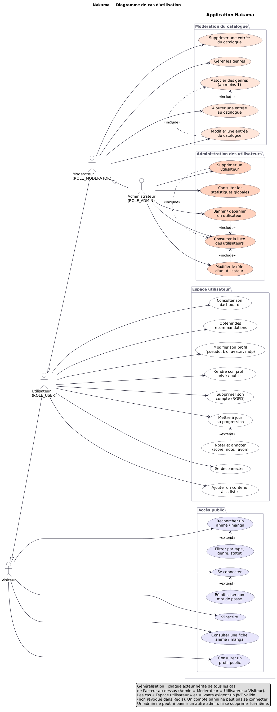
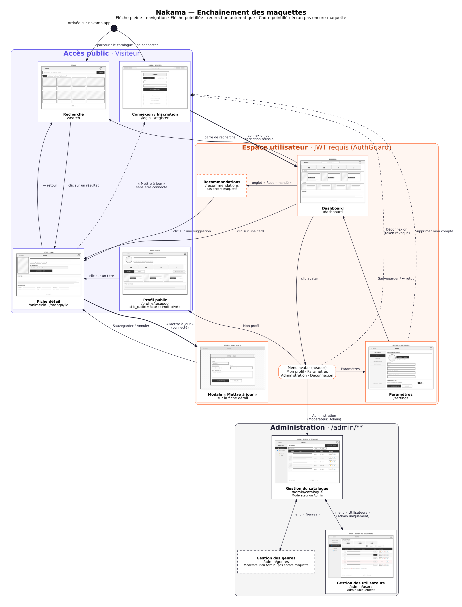

# Diagrammes UML — Nakama (milestone M1)

Les fichiers `.puml` sont les sources [PlantUML](https://plantuml.com) : c'est eux qu'on modifie. Les `.png` et `.svg` sont les images générées, à mettre dans la présentation et le dossier projet.

## Cas d'utilisation (#5)

4 acteurs liés par généralisation : Visiteur ⊂ Utilisateur ⊂ Modérateur ⊂ Administrateur.



## Diagrammes de séquence (#61)

| Diagramme | Ce qu'il montre |
|---|---|
| [01 — Inscription](sequence/01-inscription.png) | Validation front + back, unicité email/pseudo (409), BCrypt, création du compte et du profil dans une seule transaction, JWT |
| [02 — Connexion JWT + Redis](sequence/02-connexion-jwt-redis.png) | Login (401 / 403 banni / 200 + JWT), puis requête authentifiée : `JwtFilter` vérifie la signature et la liste noire Redis |
| [03 — Déconnexion Redis](sequence/03-deconnexion-redis.png) | `SET jwt:blacklist:<jti> <user_id> EX <ttl>`, puis refus (401) du token révoqué |
| [04 — Progression](sequence/04-mise-a-jour-progression.png) | Ajout ou mise à jour d'un tracking, règles métier (400), verrou optimiste (409), triggers V2 |

## Diagrammes d'activité (#12)

| Diagramme | Parcours du CDC |
|---|---|
| [01 — S'authentifier](activite/01-authentification.png) | Parcours 1 et 2 |
| [02 — Suivre sa progression](activite/02-suivi-progression.png) | Parcours 3 et 4 |
| [03 — Consulter un profil](activite/03-consulter-profil.png) | Parcours 5 |
| [04 — Recommandations](activite/04-recommandations.png) | Règles « Recommandations » |
| [05 — Ajouter au catalogue](activite/05-ajouter-entree-catalogue.png) | Parcours 6 |
| [06 — Bannir un utilisateur](activite/06-bannir-utilisateur.png) | Parcours 7 |

## Enchaînement des maquettes (#62)

Source : `enchainement-maquettes/enchainement-maquettes.dot` (Graphviz), miniatures des wireframes dans `miniatures/`.



## Régénérer les images

```bash
# PlantUML (Java requis) : https://plantuml.com/download
java -jar plantuml.jar -tpng -tsvg docs/03-conception/uml/**/*.puml

# Graphviz : sudo apt install graphviz
cd docs/03-conception/uml/enchainement-maquettes
dot -Tpng enchainement-maquettes.dot -o enchainement-maquettes.png
```

Plus simple : l'extension **PlantUML** de VS Code affiche l'aperçu avec `Alt + D`.
